<!-- datasheet:banner -->

  <picture>
    <source media="(prefers-color-scheme: dark)" srcset=".github/assets/banner-dark.svg">
    
  </picture>

<!-- /datasheet:banner -->

# Heater Driver 12 V / 100 W — v4 (All Through-Hole, Runs Cool, OCP + OTP)

Rev 4.0 · 2026-10-17 · KiCad 9.0 project · 2-layer, **54 × 42 mm** · **100 % through-hole parts**

v4 builds on v3 with three goals:
1. **It can't cook itself.** It uses a 1.3 mΩ MOSFET and adds over-temperature shutdown on top of overcurrent shutdown.
2. **Every part is through-hole.**
3. **A step-by-step placement guide** shows where every part goes.

Start with **`docs/heater_driver_v4_placement_guide.pdf`**.

---

<!-- datasheet:figure -->
## At a glance

  <picture>
    <source media="(prefers-color-scheme: dark)" srcset=".github/assets/diagram-dark.svg">
    
  </picture>

| Characteristic | Detail |
| --- | --- |
| **Rating** | 12 V, 100 W (8.33 A) into a heater load; 2-layer board, 54 × 42 mm, 100 % through-hole |
| **Switch** | 1.3 mΩ MOSFET Q1 dissipating about 0.09 W at full load |
| **Protection** | Latching overcurrent (gate off about 7 µs after a short), latching over-temperature at about 84 °C, 15 A fuse, TVS clamp |
| **Verification** | Copper current check to IPC-2221, simulation reports and a step-by-step placement guide in `docs/` |
<!-- /datasheet:figure -->

## 1. Folder contents

| Path | What it is |
|---|---|
| `docs/heater_driver_v4_placement_guide.pdf` | **Assembly guide.** Board map, solder order, full placement table (value, part number, X/Y, orientation, polarity), and one card per component showing exactly where it goes. |
| `docs/heater_driver_v4_test_checklist.pdf` | 24-step bring-up and test (includes an over-temperature test) |
| `docs/heater_driver_v4_schematic.pdf / .png` | Schematic, 6 labelled blocks |
| `docs/heater_driver_v4_layout.pdf`, `*_layout_top/bottom.png` | Layout (top, bottom, assembly pages) |
| `docs/heater_driver_v4_assembly_drawing.pdf` | KiCad assembly drawing (all reference designators) |
| `docs/gerber_check_*.png` | Gerbers re-rendered by an independent viewer (gerbv) |
| `fab/heater_driver_v4_GERBERS_for_fab.zip` | **Upload this to the PCB fab** |
| `bom/heater_driver_v4_BOM.csv`, `bom/heater_driver_v4_CPL_all.csv` | Parts list with part numbers, part positions |
| `heater_driver_v4.kicad_pro / .kicad_sch / .kicad_pcb` | KiCad project (open the `.kicad_pro`) |
| `sim/` | ngspice virtual test (overcurrent, latch, reset, over-temperature) |
| `reports/` | ERC, DRC (with schematic parity), copper current check |
| `scripts/` | Generators (design → schematic → PCB → exports → guide) |

---

## 2. What changed from v3 → v4

| | v3 | **v4** |
|---|---|---|
| Parts | THT + 2 SMD (2512 shunt, 0805) | **100 % through-hole** |
| MOSFET | IRF3205, 8 mΩ → 0.56–0.8 W | **IRFB7430, 1.3 mΩ → ~0.1 W** (≈ +10 °C, no heatsink) |
| Shunt | 2512 SMD on the PCB | **TT/IRC OAR3R010FLF open-air 3 W strap**, stands up in free air, Kelvin sense squares |
| Thermal protection | none | **NTC TH1 next to the shunt and MOSFET.** Above ~84 °C the board latches OFF (same red LED and RESET as overcurrent). |
| Comparator | LM393 | **LM339** (4 comparators: overcurrent trip, latch, over-temperature, spare) |
| Board | 50 × 38 mm | 54 × 42 mm. Grew to fit the new parts; the high-current loop is now a tight ring on the right side. |

Kept from v3:
- isolated, non-inverting PWM input (heater is off when the MCU is unplugged)
- 15 A ATM fuse, 1.5KE18A TVS, 1N5822 flyback
- 11.9 A latching overcurrent trip
- safe RESET (protection stays active while the button is held)

---

## 3. Why it won't burn itself

| Heat source / hazard | v4 figure | Protection |
|---|---|---|
| MOSFET Q1 | 8.33² × 1.3 mΩ = **0.09 W** (≈ 0.15 W hot), simulated 0.08 W | none needed |
| Shunt RS1 | 0.69 W in a **3 W** open-air strap (23 %) | TH1 watches it |
| PCB copper, 8.33 A | ≤ 10.5 °C rise on every path (table below) | both layers, ≥ 5.4 mm |
| Terminals J1/J2 | 8.33 A on 13.5 A rated parts (62 %) | — |
| Short circuit | Gate off ~7 µs after the short, peak ~37 A | latching overcurrent, fuse backup |
| Overheating (blocked airflow, hot enclosure, bad joint) | NTC trips at **~84 °C** (simulated 83.8 °C) | latching over-temperature |
| RESET held into a fault | Pulsed, ~4 A average; fuse intact | protection stays active |
| Supply spikes / reverse kick | 1.5KE18A clamps at 25 V; MOSFET is rated 40 V | TVS1, D1 |
| Wiring fault / last resort | 15 A ATM fuse | F1 |

### Copper current check (`reports/trace_current_check.txt`, IPC-2221, 1 oz)

| Path (8.33 A) | Top + bottom | ΔT |
|---|---|---|
| VIN J1 → F1 | 6.1 + 6.1 mm | 2.8 °C |
| +12V F1 → TVS1 → D1 → J2 | ≥ 3.6 + 4.2 mm | ≤ 6.1 °C |
| HEAT− J2 → Q1 drain | 8.8 + 8.8 mm | 1.5 °C |
| Q1 drain pin neck (TO-220 pitch) | 2.7 + 2.7 mm | 10.5 °C (short neck, conservative) |
| SRC Q1 → RS1 | 2.8 + 2.8 mm | 10.0 °C |
| GND RS1 → J1 | 5.3 + 5.3 mm | 3.5 °C |

---

## 4. Subsystems (numbered on the silkscreen; legend on the bottom side)

1. **ISO IN**: J3, R1, D2, U2 (PC817). Takes 3.3–5 V logic, PWM ≤ 1 kHz.
2. **OCP + OTP LATCH**: U3 (LM339), the shunt filter, the 11.9 A reference, the latch network and RESET injection (R17), and the NTC divider (R18–R20, C9).
3. **GATE DRIVE**: U1 (TC4427A), Q2 fault clamp, R2–R5, ZD1, C2, R14.
4. **POWER IN + PROTECTION**: J1, F1, C1, TVS1, D1, green HEAT LED (D4/R16).
5. **POWER STAGE**: J2, Q1, RS1, TH1.
6. **UI**: SW1 RESET, red FAULT LED (D3/R15).

---

## 5. Verification

- **ERC:** 0 errors, 0 warnings.
- **DRC (with schematic parity):** 0 violations, 0 unconnected pads, 0 footprint errors.
- **Gerbers:** re-rendered with gerbv; outline, copper, drills and silkscreen all match.
- **Routing:** 3 signal vias (plus 3 ground stitching vias), every segment at 0/45/90°. High-current copper is hand-placed; signal traces were autorouted with the optimizer on.
- **Simulation** (`sim/sim_overview.png`):

| Scenario | Result |
|---|---|
| Normal running | 8.1 A, Vgs 11.7 V, Q1 0.08 W |
| Power-up | No false trip (FAULT 0.11 V) |
| Dead short | Off in ~7 µs, latched |
| RESET | Normal operation resumes |
| RESET held into a short | Pulsed, 4.0 A average |
| NTC ramped 25 → 105 °C | Trips at **83.8 °C**, latched off |

---

## 6. Ordering and building

**PCB:** upload `fab/heater_driver_v4_GERBERS_for_fab.zip` and choose:
- 2 layers, FR-4, 1.6 mm, 1 oz (2 oz optional), 54 × 42 mm
- HASL or ENIG finish
- minimums used: 0.3 mm track, 0.2 mm clearance, 0.35 mm smallest drill

**Parts:** `bom/heater_driver_v4_BOM.csv` lists all 46 parts (every one through-hole) with manufacturer part numbers.

**Building:** follow the placement guide in solder order:
1. resistors
2. small diodes
3. ceramic capacitors
4. ICs
5. Q2, LEDs, NTC
6. switch
7. big diodes
8. C1
9. Q1 and RS1
10. fuse holder and terminals

Then work through the test checklist.

---

## 7. Honest notes

- The board is **54 × 42 mm**: 9 % larger than v2 and 19 % larger than v3. That's the cost of going 100 % through-hole and adding over-temperature protection.
- **IRFB7430PBF** is the primary MOSFET. IRLB3034PBF (1.7 mΩ) is a drop-in alternative; one distributor lists it as no longer manufactured, so check stock.
- **OAR3R010FLF:** lead pitch (15.24 mm) and lead diameter (1.02 mm) come from distributor listings. Check them against the TT Electronics OAR datasheet before ordering the board.
- **Silkscreen designators:** C5, C7, R7, R13, J1 and J2 don't fit visibly on the dense top silkscreen. The placement guide and assembly drawing show every part.
- **The ~84 °C threshold** is set by R20 (11 k) and depends on how well TH1 touches the shunt/MOSFET copper. Bend it so the bead leans against the RS1 strap.
- **Simulation scope:** the simulation uses behavioural models for the PC817, TC4427 and LM339. Treat it as a logic and timing check, then run the real tests in the checklist.

## License

MIT. See [LICENSE](LICENSE).
